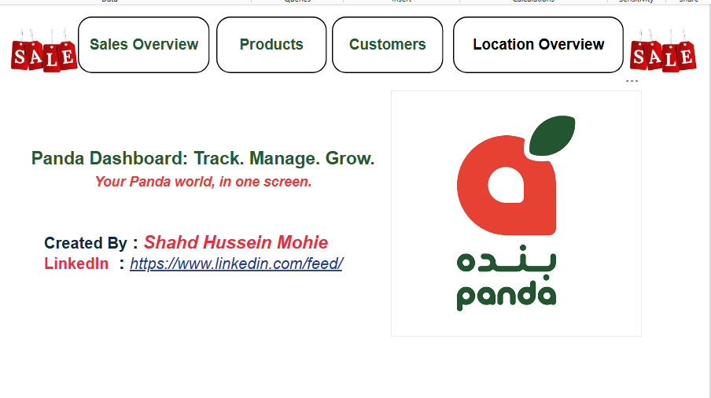
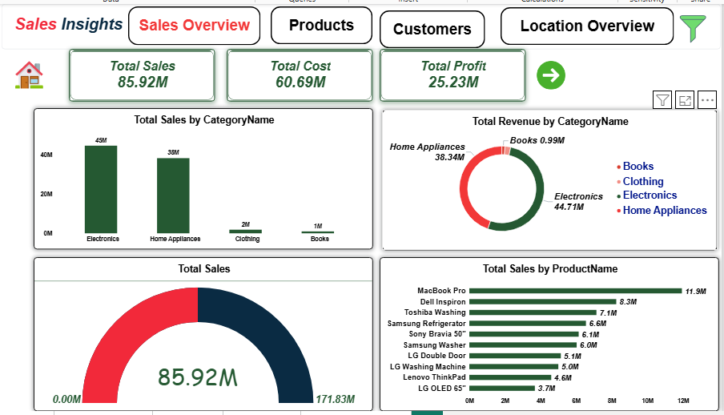

# 🐼 Panda Market Sales Dashboard | Power BI
### Turning Retail Sales Data into Business Insights

  <b>An interactive Business Intelligence project exploring Panda Market sales performance across multiple product lines, regional footprints, customer demographics, and operating profit margins.</b>
   
  <i>Track. Manage. Grow. — Your Panda World in One Screen.</i>

---

## 📌 Project Overview

The **Panda Market Sales Dashboard** is an interactive Power BI business intelligence project developed to explore retail sales performance across multiple calendar years, product categories, geographic locations, and customer groups.

The project transforms raw retail transaction records into meaningful visual insights, allowing decision-makers to investigate performance trends, evaluate category margins, track operational volume, and explore market penetration across continents and cities.

### 📋 Project at a Glance

| Project Detail | Description |
| :--- | :--- |
| **Project Name** | Panda Market Sales Dashboard |
| **Domain** | Retail & E-Commerce Sales Analytics |
| **Reporting Period** | 2023 – 2025 |
| **Selected Categories** | Electronics, Home Appliances, Clothing, Books |
| **Filtered Records** | 50,005 Sales Transactions (50,000 Unique Invoices) |
| **Main Tool** | Microsoft Power BI Desktop & Power BI Service |
| **Data Preparation** | Power Query (ETL, Type Casting, Key Relationship Setup) |
| **Analytical Calculations** | DAX (Explicit Measures, Time Intelligence, Profit Margins) |

> **Important:** Each row in `Fact_Sales` represents an individual line item sold within an invoice. Total revenue is calculated using `TotalAmount`, and total units sold are calculated by summing `Quantity`.

---

## 📸 Dashboard Preview

### 1. Cover / Home Page

  

### 2. Sales Overview Dashboard

  

> *The Sales Overview page summarizes high-level performance metrics, tracking top revenue-generating categories, top products, and overall sales pace against milestone targets.*

---

## 📑 Table of Contents
- [Project Overview](#-project-overview)
- [Dashboard Preview](#-dashboard-preview)
- [Business Objectives](#-business-objectives)
- [Dataset](#-dataset)
- [Data Preparation](#-data-preparation)
- [Dashboard Pages](#-dashboard-pages)
- [Key Features](#-key-features)
- [Key Performance Indicators](#-key-performance-indicators)
- [Key Insights](#-key-insights)
- [DAX Measures](#-dax-measures)
- [Project Demonstration](#-project-demonstration)
- [Download Dashboard](#-download-dashboard)
- [Limitations & Considerations](#-limitations--considerations)
- [About the Author](#-about-the-author)
- [Feedback](#-feedback)

---

## 🎯 Business Objectives

The project explores the following analytical questions:

- **Revenue & Pace:** What is our total gross revenue, overall cost burden, and net operating profit?
- **Category Contribution:** Which product categories (Electronics, Home Appliances, Clothing, Books) drive high volume vs. high profit?
- **Product Velocity:** Which specific products represent the top revenue generators, and which products lead in quantity sold?
- **Regional Performance:** How are sales distributed across continental regions (MENA, North America, Europe) and countries (Saudi Arabia, USA, Germany, Egypt)?
- **Customer Profiling:** What is the average order value (AOV), and how does purchasing volume vary between male and female customer segments?
- **Quarterly Seasonality:** How does sales momentum shift across quarterly cycles (Q1 to Q4)?

These questions demonstrate how business intelligence tools can organize complex retail operations and support data-driven decision-making.

---

## 📂 Dataset

The data model represents an enterprise retail ecosystem containing transaction records along with detailed product, customer, and geographical dimensions.

### Dataset Tables

| Table | Description |
| :--- | :--- |
| **`Fact_Sales`** | Transaction-level sales records including `InvoiceNo`, `InvoiceDate`, `CustomerID`, `ProductID`, `Quantity`, `UnitPrice`, and `TotalAmount`. |
| **`Dim_Product`** | Product master data containing `ProductID`, `ProductName`, `SubCategoryID`, `Price`, and unit `Cost`. |
| **`Dim_Category`** | Product vertical classification (`Electronics`, `Home Appliances`, `Clothing`, `Books`). |
| **`Dim_SubCategory`**| Granular subcategories (Laptops, Washing Machines, Refrigerators, Mobile Phones, Fiction, etc.). |
| **`Dim_Customer`** | Customer demographic records including `CustomerID`, `Name`, `Gender`, `Age`, `LocationID`, and `RegistrationDate`. |
| **`Dim_Location`** | Geographic mapping with `LocationID`, `City`, `State`, and `CountryID`. |
| **`Dim_Country`** | Country mapping containing `CountryID`, `Country`, and macro `Region`. |
| **`Dim_Date`** | Calendar dimension providing `Date`, `Day`, `Month Name`, `Quarter`, and `Year`. |

---

## 🧹 Data Preparation

**Power Query** was utilized to prepare and model the dataset before reporting:

1. **Importing & Schema Verification:** Ingested all CSV files and verified data integrity across relational keys.
2. **Data Type Casting:** Assigned appropriate numerical formats (Currency for financial figures, Whole Numbers for quantities, and Date formats for timestamps).
3. **Star Schema Implementation:** Structured the relationships into a clean **Star Schema** with one central Fact table connected to surrounding Dimension tables with 1-to-Many ($1:*$) cardinalities and single cross-filter direction:
