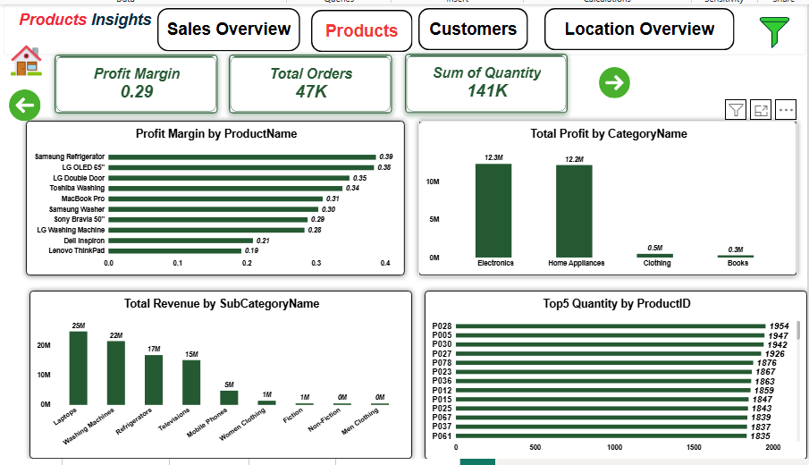
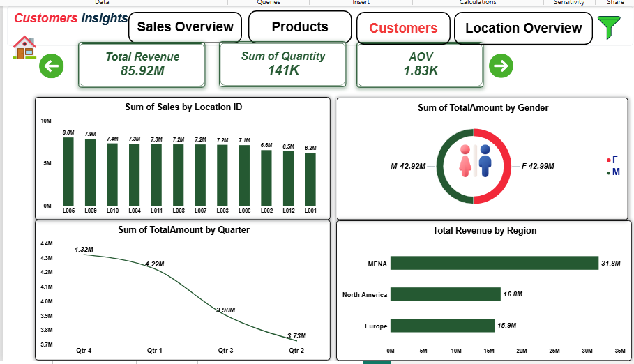
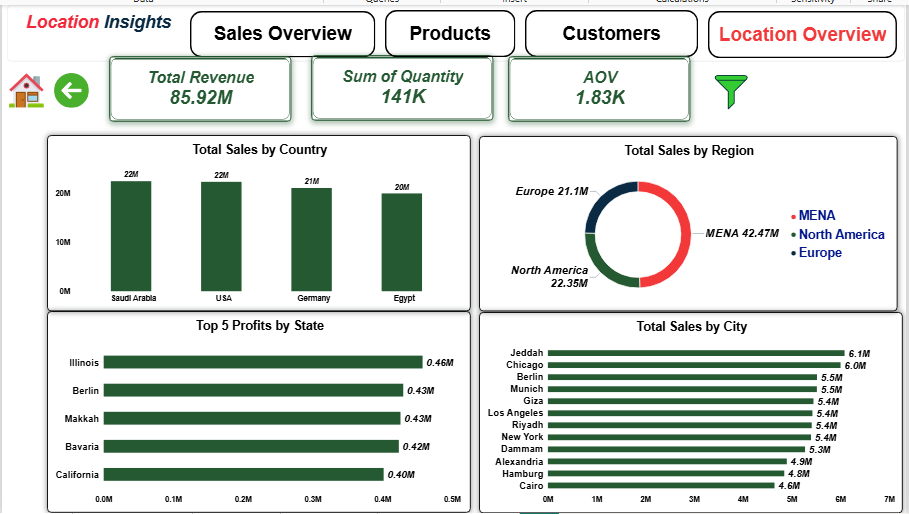
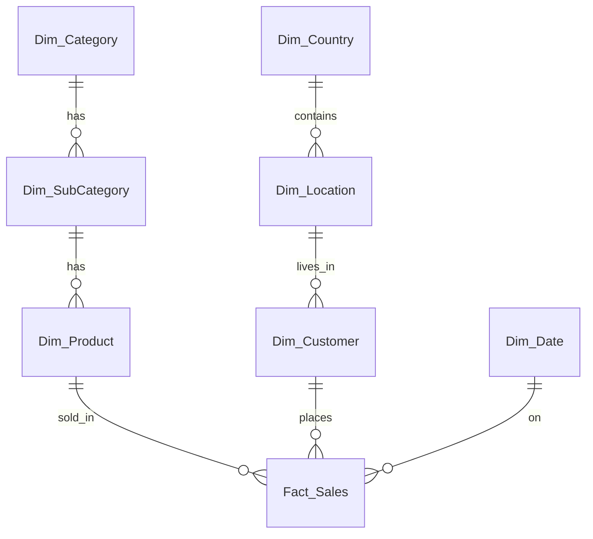

<div align="center">

# 🐼 Panda Market Sales Dashboard | Power BI
### Turning Retail Sales Data into Business Insights

[](https://powerbi.microsoft.com/)
[](https://learn.microsoft.com/en-us/dax/)
[](#-data-preparation)
[](#)

<p align="center">
  <b>An interactive Business Intelligence project exploring Panda Market sales performance across product lines, regional footprints, customer demographics, and operating profit margins.</b>
  <br />
  <i>Track. Manage. Grow. — Your Panda World in One Screen.</i>
</p>

</div>

---

## 📌 Project Overview

The **Panda Market Sales Dashboard** is an interactive Power BI project built to explore retail sales performance across product categories, geographic locations, and customer groups.

The project transforms raw retail transaction records into visual insights, helping decision-makers investigate performance trends, evaluate category margins, track sales volume, and explore market penetration across regions, countries, and cities.

### 📋 Project at a Glance

| Project Detail | Description |
| :--- | :--- |
| **Project Name** | Panda Market Sales Dashboard |
| **Domain** | Retail & E-Commerce Sales Analytics |
| **Sales Period** | 18 Aug 2023 – 17 Aug 2025 |
| **Categories** | Electronics, Home Appliances, Clothing, Books |
| **Records** | 50,005 sales lines (50,000 unique invoices) |
| **Dashboard Pages** | 5 (Home, Sales Overview, Products, Customers, Location Overview) |
| **Main Tool** | Microsoft Power BI Desktop |
| **Data Preparation** | Power Query (type casting, key relationships) |
| **Calculations** | DAX (explicit measures, profit margin, AOV) |

> **Important:** Each row in `Fact_Sales` is a single line item within an invoice. Revenue is calculated from `TotalAmount`, and units sold from the sum of `Quantity`.

---

## 📸 Dashboard Preview

### 1. Cover / Home Page
<p align="center">
  
</p>

> *The landing page with project title, author credit, and navigation buttons to every report page.*

### 2. Sales Overview
<p align="center">
  
</p>

> *High-level KPIs (Total Sales, Total Cost, Total Profit), sales by category, top products, and a gauge tracking total sales against a milestone target.*

### 3. Products Insights
<p align="center">
  
</p>

> *Profit margin by product, profit by category, revenue by subcategory, and the top products by quantity sold.*

### 4. Customers Insights
<p align="center">
  
</p>

> *Customer-side view: sales by location ID, revenue split by gender, quarterly trend, and revenue by region.*

### 5. Location Insights
<p align="center">
  
</p>

> *Geographic view: sales by country, region share, top profit states, and sales by city.*

---

## 📑 Table of Contents
- [Project Overview](#-project-overview)
- [Dashboard Preview](#-dashboard-preview)
- [Business Objectives](#-business-objectives)
- [Dataset](#-dataset)
- [Data Preparation](#-data-preparation)
- [Dashboard Pages](#-dashboard-pages)
- [Key Features](#-key-features)
- [Key Performance Indicators](#-key-performance-indicators)
- [Key Insights](#-key-insights)
- [DAX Measures](#-dax-measures)
- [Project Demonstration](#-project-demonstration)
- [Download Dashboard](#-download-dashboard)
- [Repository Structure](#-repository-structure)
- [Limitations & Considerations](#-limitations--considerations)
- [About the Author](#-about-the-author)
- [Feedback](#-feedback)

---

## 🎯 Business Objectives

The project explores the following analytical questions:

- **Revenue & Profit:** What are total revenue, total cost, and net profit?
- **Category Contribution:** Which categories (Electronics, Home Appliances, Clothing, Books) drive the most revenue and profit?
- **Product Performance:** Which products generate the most revenue, which have the best margins, and which sell the most units?
- **Regional Performance:** How are sales distributed across regions (MENA, North America, Europe) and countries (Saudi Arabia, USA, Germany, Egypt)?
- **Customer Profiling:** What is the average order value (AOV), and how do male and female customers compare?
- **Seasonality:** How do sales shift across quarters?

---

## 📂 Dataset

The data model represents a retail ecosystem: one transaction table surrounded by product, customer, geography, and calendar dimensions. All source files are included in this repository.

### Dataset Tables

| Table | File | Rows | Description |
| :--- | :--- | :---: | :--- |
| **`Fact_Sales`** | [`Fact_Sales.csv`](Fact_Sales.csv) | 50,005 | Transaction lines: `InvoiceNo`, `InvoiceDate`, `CustomerID`, `ProductID`, `Quantity`, `UnitPrice`, `TotalAmount`. |
| **`Dim_Product`** | [`Dim_Product.csv`](Dim_Product.csv) | 80 | `ProductID`, `ProductName`, `SubCategoryID`, `Price`, `Cost`. |
| **`Dim_SubCategory`** | [`Dim_SubCategory.csv`](Dim_SubCategory.csv) | 9 | `SubCategoryID`, `SubCategoryName`, `CategoryID` (Laptops, Washing Machines, Refrigerators, Mobile Phones, Fiction, etc.). |
| **`Dim_Category`** | [`Dim_Category.csv`](Dim_Category.csv) | 4 | `CategoryID`, `CategoryName` (Electronics, Home Appliances, Clothing, Books). |
| **`Dim_Customer`** | [`Dim_Customer.csv`](Dim_Customer.csv) | 2,000 | `CustomerID`, `Name`, `Gender`, `Age`, `LocationID`, `RegistrationDate`. |
| **`Dim_Location`** | [`Dim_Location.csv`](Dim_Location.csv) | 12 | `LocationID`, `City`, `State`, `CountryID`. |
| **`Dim_Country`** | [`Dim_Country.csv`](Dim_Country.csv) | 4 | `CountryID`, `Country`, `Region`. |
| **`Dim_Date`** | [`Dim_Date.csv`](Dim_Date.csv) | 1,095 | `DateID`, `Date`, `Day`, `Month`, `Quarter`, `Year`. |

### Data Model (Star Schema)



---

## 🧹 Data Preparation

**Power Query** was used to prepare and model the dataset before reporting:

1. **Importing & Schema Verification:** Loaded all CSV files and checked relational keys between tables.
2. **Data Type Casting:** Applied currency format to financial columns, whole numbers to quantities, and date format to timestamps.
3. **Star Schema Implementation:** Related `Fact_Sales` to the dimension tables using one-to-many (1:*) relationships with single cross-filter direction. Product, subcategory, and category tables form one chain, as do customer, location, and country.

---

## 🗂️ Dashboard Pages

| # | Page | Purpose |
| :-: | :--- | :--- |
| 1 | **Home** | Cover page with title, author, and navigation buttons. |
| 2 | **Sales Overview** | Total Sales, Total Cost, Total Profit; sales by category and product; sales gauge. |
| 3 | **Products** | Profit margin, total orders, quantity; margin by product; profit by category; revenue by subcategory; top 5 products by quantity. |
| 4 | **Customers** | Total revenue, quantity, AOV; sales by location ID; revenue by gender; quarterly sales; revenue by region. |
| 5 | **Location Overview** | Sales by country, region, and city; top 5 profit states. |

---

## ✨ Key Features

- 🧭 **Custom navigation:** page buttons, home button, and next/previous arrows on every page.
- 🎛️ **Interactive filtering:** a filter pane and cross-highlighting between visuals.
- 🎨 **Consistent branding:** Panda green and red color palette across all pages.
- 📊 **Multiple visual types:** bar charts, donut charts, gauge, line chart, and KPI cards.
- 🧮 **Explicit DAX measures** for revenue, cost, profit, margin, and AOV.

---

## 📈 Key Performance Indicators

| KPI | Value |
| :--- | :---: |
| **Total Sales (Revenue)** | 85.92M |
| **Total Cost** | 60.69M |
| **Total Profit** | 25.23M |
| **Profit Margin** | 0.29 (≈ 29%) |
| **Total Orders** | 47K |
| **Total Quantity Sold** | 141K |
| **Average Order Value (AOV)** | 1.83K |

---

## 💡 Key Insights

### 🛒 Sales & Categories
- **Electronics** leads with **44.71M** in revenue, followed by **Home Appliances** at **38.34M**. Together they make up roughly 97% of all sales.
- **Clothing** (~2M) and **Books** (0.99M) contribute very little revenue.
- Profit follows the same pattern: Electronics **12.3M**, Home Appliances **12.2M**, Clothing **0.5M**, Books **0.3M**.

### 📦 Products
- **MacBook Pro** is the top seller at **11.9M**, followed by Dell Inspiron (8.3M), Toshiba Washing (7.1M), and Samsung Refrigerator (6.6M).
- The best margins belong to **Samsung Refrigerator (0.39)**, **LG OLED 65" (0.38)**, and **LG Double Door (0.35)**. The lowest are **Lenovo ThinkPad (0.19)** and **Dell Inspiron (0.21)**, so high revenue does not always mean high margin.
- By subcategory, **Laptops (25M)**, **Washing Machines (22M)**, **Refrigerators (17M)**, and **Televisions (15M)** dominate.
- The top 5 products by units sold (P028, P005, P030, P027, P078) are all close, between roughly 1,876 and 1,954 units.

### 👥 Customers
- Revenue is almost evenly split by gender: **Male 42.92M** vs **Female 42.99M**.
- AOV is **1.83K**, driven by high-ticket electronics and appliances.
- Sales by location ID range from 8.0M (L005) down to 6.2M (L001), so no single location dominates.

### 🌍 Locations
- **MENA** is the largest region at **42.47M**, followed by **North America (22.35M)** and **Europe (21.1M)**.
- Country sales are close: **Saudi Arabia 22M**, **USA 22M**, **Germany 21M**, **Egypt 20M**.
- **Jeddah (6.1M)** and **Chicago (6.0M)** are the top cities.
- The most profitable states are **Illinois (0.46M)**, **Berlin (0.43M)**, **Makkah (0.43M)**, **Bavaria (0.42M)**, and **California (0.40M)**.

---

## 🧮 DAX Measures

The measures below reflect the logic behind the dashboard KPIs. The full, exact versions are inside the `.pbix` file.

```DAX
Total Sales = SUM ( Fact_Sales[TotalAmount] )

Total Cost = SUMX ( Fact_Sales, Fact_Sales[Quantity] * RELATED ( Dim_Product[Cost] ) )

Total Profit = [Total Sales] - [Total Cost]

Profit Margin = DIVIDE ( [Total Profit], [Total Sales] )

Sum of Quantity = SUM ( Fact_Sales[Quantity] )

Total Orders = DISTINCTCOUNT ( Fact_Sales[InvoiceNo] )

AOV = DIVIDE ( [Total Sales], [Total Orders] )
```

---

## 🎬 Project Demonstration

A full walkthrough of the dashboard is available as a video:

<p align="center">
  <a href="Panda_Market_Dashboard.mp4">
    
  </a>
  <br />
  <b>▶️ <a href="Panda_Market_Dashboard.mp4">Watch the demo video (Panda_Market_Dashboard.mp4)</a></b>
</p>

---

## ⬇️ Download Dashboard

| File | Description |
| :--- | :--- |
| 📊 [**Panda_Dashboard.pbix**](Panda_Dashboard.pbix) | The Power BI report file. Open it with **Power BI Desktop**. |
| 🎬 [**Panda_Market_Dashboard.mp4**](Panda_Market_Dashboard.mp4) | Video walkthrough of the project. |
| 📁 [Dataset CSV files](#-dataset) | All eight source tables, in the repository root. |

---

## 🗃️ Repository Structure

```
📦 Panda-Market-Dashboard
 ┣ 📄 README.md
 ┣ 📊 Panda_Dashboard.pbix
 ┣ 🎬 Panda_Market_Dashboard.mp4
 ┣ 🖼️ D1.PNG  (Home)
 ┣ 🖼️ D2.PNG  (Sales Overview)
 ┣ 🖼️ D3.PNG  (Products)
 ┣ 🖼️ D4.PNG  (Customers)
 ┣ 🖼️ D5.PNG  (Location Overview)
 ┣ 📄 Fact_Sales.csv
 ┣ 📄 Dim_Product.csv
 ┣ 📄 Dim_SubCategory.csv
 ┣ 📄 Dim_Category.csv
 ┣ 📄 Dim_Customer.csv
 ┣ 📄 Dim_Location.csv
 ┣ 📄 Dim_Country.csv
 ┗ 📄 Dim_Date.csv
```

---

## ⚠️ Limitations & Considerations

- The dataset is **synthetic/educational**, so results do not represent a real company.
- The project is a **descriptive analysis**; it does not include forecasting or statistical testing.
- Profit is calculated from the unit cost in `Dim_Product`, with no other operating expenses.
- Quarterly figures should be read with care: `Dim_Date.csv` covers 2021–2023, while sales run from August 2023 to August 2025, so the date relationship does not match every sale.
- Revenue is heavily concentrated in Electronics and Home Appliances, so Clothing and Books have limited influence on overall results.

---

## 👤 About the Author

<div align="center">

**Shahd Hussein Mohie**
*Data Analyst | Power BI*

[](https://www.linkedin.com/feed/)

</div>

I build interactive dashboards that turn raw data into clear business insights. This project was created to practice data modeling, DAX, and dashboard storytelling in Power BI.

---

## 💬 Feedback

Feedback and suggestions are welcome. If you found this project useful:

- ⭐ Star the repository
- 🍴 Fork it and build your own version
- 💼 Reach out on [LinkedIn](https://www.linkedin.com/feed/)

<div align="center">

**Thank you for visiting! 🐼**

</div>
